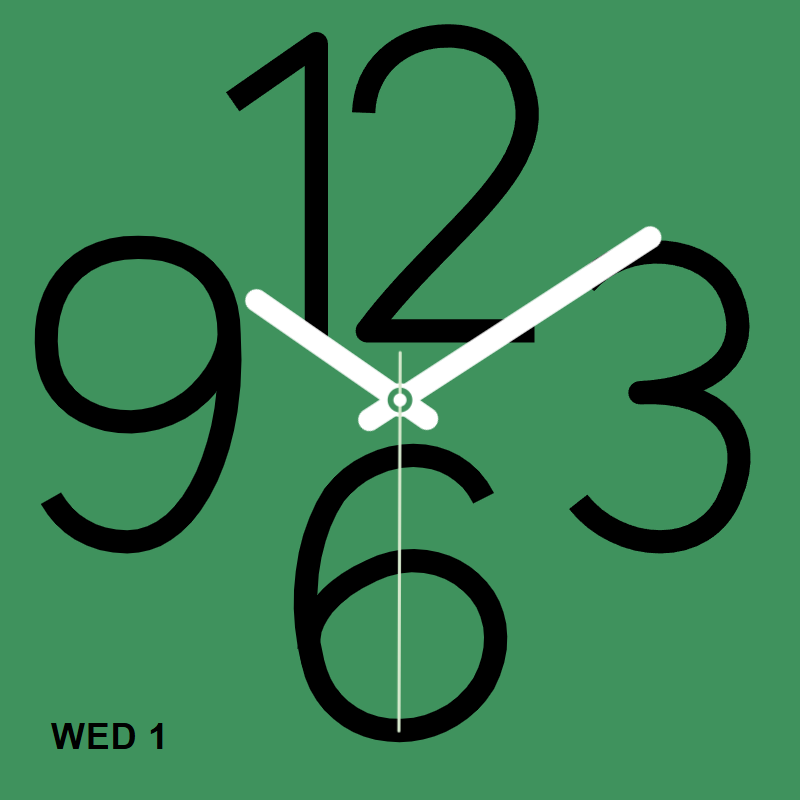

# Watch Clock for Kiosk Satellite

A standalone SDK 1 screensaver plugin inspired by the supplied green watch face. Oversized vector numerals, white rounded hands and a fine sweeping seconds hand fill a clean, solid background. There is no watch bezel, web configuration screen, network dependency or external font.



## Install from GitHub

Enable plugins in **Settings > Plugin Manager**, choose **Add plugin**, paste `https://github.com/dark-matter-design/kiosk-satellite-watch-clock-screensaver`, review the release and choose **Trust and install**.

## Install locally

1. Enable plugins in **Settings > Plugin Manager** in Kiosk Satellite.
2. Open **Developer Tools > Install from ZIP** on the kiosk or Remote Admin and select `dist/watch-clock-1.0.1.zip`.
3. Review and trust the code, then enable **Watch Clock**.
4. Choose **Screensaver > Screensaver mode > Watch Clock (Watch Clock)**. The same entry is available in screensaver schedules.

Requires Android 7.0+ and a current Kiosk Satellite build supporting SDK 1 asset screensavers and conditional native settings. The package requests only `screensaver`. Local installation does not require a GitHub release. Installing a replacement local ZIP preserves compatible settings and the enabled state. A local package cannot replace a GitHub-installed copy; see the official installation documentation before switching sources.

## Native settings

Open **Plugin Manager > Watch Clock**. Settings apply to an active clock through KS's documented document refresh, without restarting the app.

| Setting | Default / choices |
| --- | --- |
| Colour scheme | Original Green; Midnight Black, Deep Blue, Navy, Red, Orange, Purple, Pink, Cream, White, Custom |
| Custom colours | Background, numerals, hour/minute hands, seconds, pivot, date; native colour pickers appear for Custom |
| Layout | Original proportions (default), Adaptive |
| Scale | 100%; adjustable 50–100% to keep the complete clock visible |
| Alignment | Centre (default), Left, Right, Top, Bottom |
| Clock pixel shift | Enabled; moves clock content once per minute while keeping the background fixed. Turn off host-wide Screensaver > Pixel shift |
| Seconds hand | Enabled |
| Date | Enabled; Bottom left (default), Bottom right, Top left, Top right |
| Date format | Short weekday + day (default), Day + short month, Numeric date |
| Time zone | Local (device time zone), or an IANA name such as `Australia/Sydney` or `UTC` |

**Precedence:** a named preset supplies all six colours and ignores saved custom colours. Custom uses the six saved picker values; switching presets does not overwrite them. Invalid custom hex colours fall back to the green theme's corresponding value. An invalid time zone falls back to device local time. The default date uses the device locale's weekday/day text, uppercase and ordered like `WED 1`; other formats use locale ordering. The date updates across midnight and time corrections.

Original proportions centres the square composition in any viewport and fills all remaining space with its background. Adaptive moves the cardinal numerals outward along the longer axis, up to 1.65 times the square dimension. Numerals and hands keep their proportions, and the pivot stays centred. Extreme aspect ratios retain background margins. All sizing follows the actual viewport, including the smaller area alongside Now Playing. Alignment places the composition within that viewport; KS pixel shift can still move the whole surface.

## Build and test

Based on the official [Hello World template](https://github.com/jxlarrea/kiosk-satellite-plugin-hello-world), source revision `fa121064e72d7d321464cdd69b3757951c47623a`. The unmodified SDK sources and Apache license are retained. Rendering follows the [screensaver API](https://github.com/jxlarrea/kiosk-satellite-plugin-hello-world/blob/main/docs/screensavers.md).

Install Python 3, JDK 17+ (tested with 21), Node.js 18+, and Android SDK platform 35 / build-tools 35.0.0. Set `JAVA_HOME` and `ANDROID_HOME`; put Node on PATH or set `NODE` to its executable.

```sh
python3 tools/test.py
python3 tools/build.py
```

On Windows, `python` can be used instead of `python3`. If using the workspace-local toolchain prepared during development, run:

```powershell
$env:JAVA_HOME = (Get-ChildItem .toolchain/jdk -Directory | Select-Object -First 1).FullName
$env:ANDROID_HOME = Join-Path (Get-Location) '.toolchain/android-sdk'
python tools/test.py
python tools/build.py
```

The builder produces `dist/watch-clock-1.0.1.zip`, its `.zip.sha256`, a matching standalone manifest and a compile-time SDK JAR. Only plugin DEX classes, the manifest, license, directory icon and four clock assets go into the installable ZIP; the SDK JAR is not bundled.

Optional browser validation uses Playwright and a Chromium browser:

```sh
npm install --no-save playwright@1.62.1
npx playwright install chromium
node tests/browser.test.cjs
```

Set `BROWSER_CHANNEL=chromium` for bundled Chromium, `chrome` for installed Chrome or `msedge` for installed Edge (the default). Preview PNGs are written to `docs/previews/`. Browser tooling is only for development and is never packaged.

## Implementation

`WatchClockPlugin.java` publishes `clock/index.html` with scalar settings during start and when effective options change, and removes it on stop. The stable mode is `plugin:watch-clock:clock`. It has no timers or host subscriptions. No renderer is published on animation frames.

`clock-core.js` contains palettes, angles and safe responsive geometry. `clock.js` uses a single `requestAnimationFrame` loop and SVG transforms. Time is interpolated with `performance.now()` between system-clock anchors, synchronized each second and immediately after a clock correction. Every hand includes fractional seconds. Hidden/page-hidden documents cancel their callback; resumption reads current time. No frame deltas are accumulated. Date text changes only when needed. All assets are local, with a restrictive content security policy.

KS owns activation, schedules, brightness, dismissal, screen-off, widgets, host-wide pixel shift and Now Playing. The plugin's Clock pixel shift moves only the clock content, keeping the background fixed; leave host-wide Screensaver > Pixel shift off to avoid moving the whole surface. Settings changes recreate the renderer as required by the SDK; they do not restart KS. The plugin does not implement any of those host policies.

The four numerals are original geometric SVG paths. No proprietary Apple typeface or artwork is included. The shapes closely approximate the reference; they are not pixel-identical to Apple's custom typography. The small date uses the device's local sans-serif font. Frame rate depends on the Android WebView and display; 60 FPS is a target, not a guarantee on all devices.

## Publish

Push this repository to your own public GitHub repository, commit the source and tag a version such as `v1.0.1`, then publish a stable GitHub release. `.github/workflows/build.yml` tests and builds the tagged source on GitHub and uploads the ZIP, checksum and matching manifest using `github.token`.

Use all three assets from the same workflow run. KS requires the uploader to be `github-actions[bot]`; manually uploaded release assets or uploads using a personal access token are rejected. Drafts and prereleases are not available through normal installation. The workflow can be retried manually against an existing release tag. See the official [release requirements](https://github.com/jxlarrea/kiosk-satellite-plugin-hello-world/blob/main/docs/creating-plugins.md#repository-and-release).

See [validation and device checklist](docs/VALIDATION.md) for automated coverage and the device acceptance checks confirmed by the maintainer on 20 October 2026. Licensed Apache-2.0; an independent community plugin, not affiliated with Apple.

